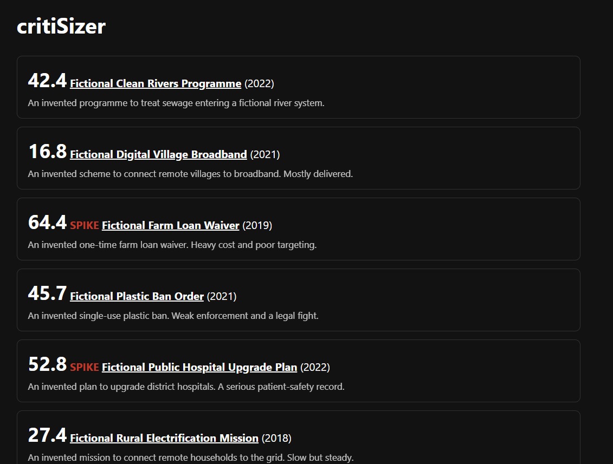
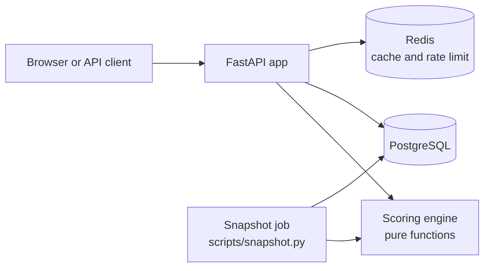

# critiSizer

[](https://github.com/akshatdwivedi824/critiSizer/actions/workflows/ci.yml)

A scorecard for government policies that measures **only what went wrong**:
failed outcomes, waste, hidden information, harm on the ground, legal
challenges and unequal impact. Each policy gets six aspect scores out of 100,
an expert average, a separate people's rating, and one overall rating, all
tied to a versioned rubric.

> **Negatives only, by design.** critiSizer shows how much criticism a policy
> has attracted and how well that criticism is evidenced. It does not score
> benefits and is not a verdict on whether a policy is good overall.
> **Scores are editorial and record negatives only.** The policies are real; a policy shows "Not yet scored" until documented evidence has been collected and reviewed.



## How it works



- **Scoring engine** (`src/critisizer/scoring/engine.py`): pure functions, no
  database, no rounding. An aspect score is the weighted mean of its
  indicators, each scaled by a verification multiplier; indicators backed only
  by unverified allegations (multiplier 0) are excluded. The overall rating
  blends the expert average with the people's rating, which stays hidden until
  enough ratings are accepted.
- **API** rounds once, at the output (half-up to one decimal).
- **PostgreSQL** holds policies, indicators, evidence, rubric versions, users,
  ratings, weekly score snapshots and an audit log.
- **Redis** caches the policy list for 60 seconds and rate-limits rating
  attempts. If Redis is down, the site keeps working: every Redis call fails
  open.
- **Snapshot job** stores each policy's scores per week and rubric version. It
  is safe to run twice.

## Run it

Windows PowerShell; needs Python 3.12, [uv](https://docs.astral.sh/uv/) and
Docker Desktop.

```powershell
uv sync
Copy-Item .env.example .env      # then set ADMIN_TOKEN to a long random value
docker compose up -d
uv run alembic upgrade head
uv run python scripts/seed.py
uv run uvicorn critisizer.main:app
```

Open http://127.0.0.1:8000/ for the scorecard and http://127.0.0.1:8000/docs
for the interactive API docs.

Useful commands:

```powershell
uv run pytest                                  # tests
uv run python scripts/snapshot.py              # store this week's snapshots
uv run python scripts/gate1.py                 # data and engine checks
uv run python scripts/gate2.py                 # API, cache and docs checks
```

## Endpoints

| Method | Path | What it does |
|---|---|---|
| GET | `/` | Scorecard page: every policy with its overall rating |
| GET | `/api/policies` | All policies with scores; cached 60 s (`X-Cache: HIT` or `MISS`) |
| GET | `/api/policies/{slug}` | One policy with its six aspect scores and evidence |
| GET | `/api/policies/{slug}/history` | Weekly snapshots, newest first |
| POST | `/api/signup` | Create an account |
| POST | `/api/login` | Get a bearer token |
| POST | `/api/policies/{slug}/ratings` | Rate a policy 0 to 100 (token needed; one per user, enforced by the database; 5 attempts per minute, then 429) |
| GET | `/api/admin/ratings` | List ratings by status (admin token) |
| POST | `/api/admin/ratings/{id}/accept` | Accept a rating; writes an audit row; clears the list cache |
| POST | `/api/admin/ratings/{id}/reject` | Reject a rating; writes an audit row |

## Measured

On one development machine with 10 policies and 4 workers: 328 requests per
second with the cache on (p95 45 ms), and about 90 requests per second with
Redis stopped (p95 580 ms at 50 users). The cost of an uncached list grows
with the number of policies: 43 queries for 10 policies, about 8,000 for
2,000. Details: [docs/load-test.md](docs/load-test.md) and the "Measured"
section of [docs/capacity.md](docs/capacity.md).

## Design decisions

- [ADR-1: database choice and score versioning](docs/adr/0001-database-and-score-versioning.md)
- [ADR-2: caching and failure behaviour](docs/adr/0002-caching-and-failure-behaviour.md)
- [Capacity estimate](docs/capacity.md)
- [Load test](docs/load-test.md)
- Day-by-day decisions and reasoning: [LOG.md](LOG.md)