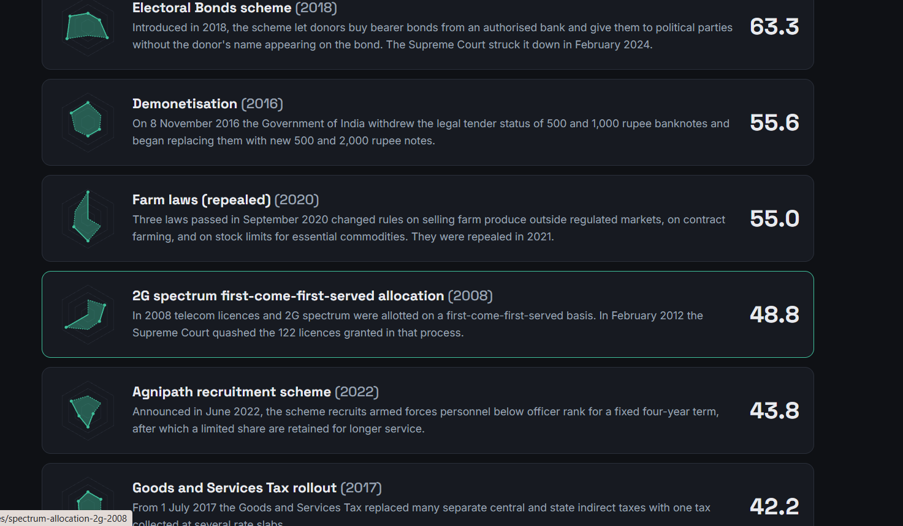
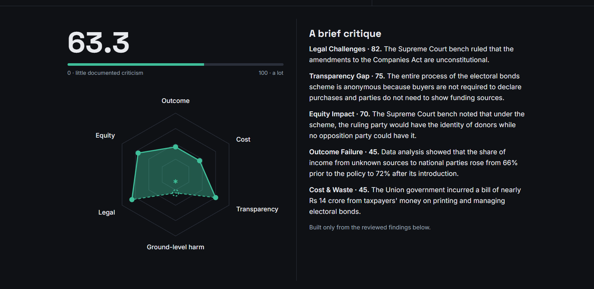
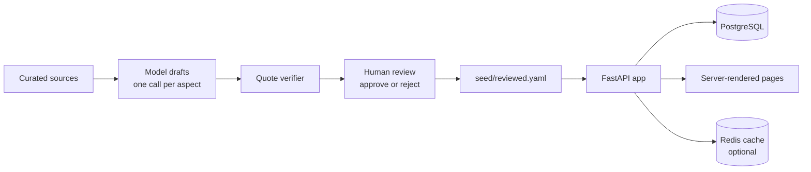

# critiSizer

[](https://github.com/akshatdwivedi824/critiSizer/actions/workflows/ci.yml)

**Live: https://critisizer.onrender.com** (free hosting; the first request after
a quiet period can take about a minute)

A scorecard for Indian government policies that measures **only what went
wrong**: failed outcomes, waste, hidden information, harm on the ground, legal
challenges and unequal impact. A policy with enough reviewed evidence gets an
overall rating out of 100, built from per-aspect scores, each traced to quotes
from named news outlets.

> **Negatives only, by design.** critiSizer shows how much criticism a policy
> has attracted and how well that criticism is evidenced. It does not score
> benefits, and a higher number means more documented criticism, not a worse
> policy overall. Content is **AI-drafted, human-reviewed**. It is editorial,
> not "objective".





## What you see

- **Home page:** every policy as a card with a miniature hexagon and its rating,
  or "Not yet rated", with a search box.
- **Policy page:** the rating, a six-axis hexagon, a short critique, and one card
  per aspect with the indicators and the exact quotes behind them. Light and
  dark themes.
- **Each aspect is in one of these states:**
  - *scored*: approved indicators backed by quotes
  - *no negative evidence*: a reviewer read the collected sources and found none; it counts as 0
  - *projected*: a named source's forecast, marked with a star, drawn dashed and **never part of the rating**
  - *too early*: a reviewer's reason and a date to look again
  - *unresolved*: not yet looked at

## How the score is made (method v2)

1. **Collect.** Curated article URLs per policy (`data/sources/<slug>.txt`) from an
   allow-list of outlets; excerpts are stored once per policy.
2. **Draft.** A free-tier model (Gemini, one call per aspect) proposes indicators.
   Each must quote the collected text; a verifier rejects any quote that is not
   in the sources.
3. **Review.** A human approves or rejects every draft. Nothing is public until
   approved. Rejections and withdrawals are written to an audit log.
4. **Score.** An aspect score is the weighted mean of its indicators, each scaled
   by a verification multiplier. A policy is **rated** only when at least four
   aspects are assessed on realised evidence, so a thin record never gets a
   headline number.
5. **Publish.** Reviewed data is exported to `seed/reviewed.yaml` and imported on
   deploy.

The model never writes a projection. A projection is entered by a reviewer, must
name its source, and must quote text already collected for that policy
(`scripts/add_projection.py`).



- **Scoring engine** (`src/critisizer/scoring/engine.py`): pure functions, no
  database, no rounding. The API rounds once, at the output (half-up to one
  decimal).
- **Pages** (`src/critisizer/render.py`, `web.py`): server-rendered HTML with
  inline CSS and a small script for the theme toggle and search. No build step.
- **PostgreSQL** holds policies, indicators, evidence, aspect reviews, rubric
  versions, users, ratings, weekly snapshots and the audit log.
- **Redis** caches the policy list for 60 seconds and rate-limits ratings. If
  Redis is down the site keeps working: every Redis call fails open.

## Run it

Windows PowerShell; needs Python 3.12, [uv](https://docs.astral.sh/uv/) and
Docker Desktop.

```powershell
uv sync
Copy-Item .env.example .env      # then set ADMIN_TOKEN to a long random value
docker compose up -d
uv run alembic upgrade head
uv run python scripts/seed.py
uv run uvicorn critisizer.main:app
```

Open http://127.0.0.1:8000/ for the scorecard and http://127.0.0.1:8000/docs
for the interactive API docs.

```powershell
uv run pytest                                  # tests
uv run ruff check .                            # lint
```

Working on the data (local database only; the scripts refuse any other host):

```powershell
uv run python scripts/add_sources.py --slug <slug> --dry-run
uv run python -m critisizer.scoring.run --slug <slug> --scorer gemini --model gemini-3.5-flash-lite
uv run python scripts/review_queue.py <slug>
uv run python scripts/review_apply.py --approve <ids> --note "quote checked"
uv run python scripts/review_apply.py --reject <ids> --reason "duplicate"
uv run python scripts/mark_aspects.py --help   # too early / no negative evidence
uv run python scripts/export_reviewed.py       # writes seed/reviewed.yaml
```

## Endpoints

| Method | Path | What it does |
|---|---|---|
| GET | `/` | Home page: every policy with its rating |
| GET | `/policies/{slug}` | One policy page |
| GET | `/api/policies` | All policies with scores; cached 60 s (`X-Cache: HIT` or `MISS`) |
| GET | `/api/policies/{slug}` | One policy with aspect scores and evidence |
| GET | `/api/policies/{slug}/history` | Weekly snapshots, newest first |
| POST | `/api/signup`, `/api/login` | Create an account, get a bearer token |
| POST | `/api/policies/{slug}/ratings` | Rate a policy 0 to 100 (one per user; 5 attempts a minute, then 429) |
| GET | `/api/admin/ratings` | List ratings by status (admin token) |
| POST | `/api/admin/ratings/{id}/accept`, `/reject` | Moderate a rating; writes an audit row |
| POST | `/api/admin/drafts/{id}/approve`, `/reject` | Review an AI draft (admin token) |
| GET | `/health`, `/metrics` | Health check and metrics |

## Known limits

- **Six of the eight policies are rated.** The Digital Personal Data Protection
  Act and the Telecommunications Act are not: each has fewer than four aspects
  assessed on realised evidence, and the rest are marked "too early" with a
  reason and a date to look again (May and June 2027). The site says so instead
  of showing a number.
- **Thin sources.** Several policies rest on a handful of articles from two to
  six outlets, and Demonetisation on only two. Each page states how many sources
  and outlets it uses. A "no negative evidence" finding means none was found in
  those sources, not that none exists.
- **Free hosting.** The app sleeps when idle and the free database is replaced
  about every month, so the data is re-imported from `seed/reviewed.yaml` on
  deploy.
- **Projected values** come from a named source, carry a star, and are excluded
  from the rating. Only Electoral Bonds has one so far.
- **Court rulings that upheld a policy** are not counted as criticism of it.
  Only the challenge itself is recorded, and the finding states how it ended.
- **Not built:** a celebrity comparator, a full load test and failure drills on
  the new data path, and a second prompt version.

## Measured

An earlier measurement on one development machine, with 10 policies and 4
workers: 328 requests per second with the cache on (p95 45 ms) and about 90
requests per second with Redis stopped (p95 580 ms at 50 users). An uncached
list costs 43 queries for 10 policies and grows with the number of policies.
Details: [docs/load-test.md](docs/load-test.md) and
[docs/capacity.md](docs/capacity.md). These figures predate the redesigned
pages and have not been re-run.

## Design decisions

- [Architecture decision records](docs/adr/): database and score versioning,
  caching and failure behaviour, and the v2 method
- [Capacity estimate](docs/capacity.md)
- [Load test](docs/load-test.md)
- Day-by-day decisions and reasoning: [LOG.md](LOG.md)